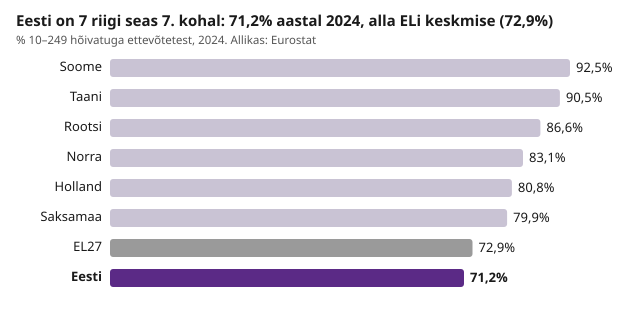

# Vähemalt baastasemel digiintensiivsusega VKEd

> Kui suur osa Eesti väikestest ja keskmistest ettevõtetest kasutab digitehnoloogiat vähemalt baastasemel võrreldes teiste riikidega?

**Staatus:** ajakohane · **Allikas uuendas:** 2026-02-27 · **Kontrollitud:** 2026-11-18 · **Järgmine oodatav uuendus:** 2028-02-27

## Number

Eesti 2024: **71,2%** · EL27: **72,9%** (% 10–249 hõivatuga ettevõtetest)

## Mida see tähendab

Digiintensiivsus loeb kokku, mitut digitehnoloogia kasutamise tunnust 12-st ettevõte täidab. Vähemalt baastasemel on ettevõte, mis täidab neist vähemalt neli. Tehisaru kasutus on üks tunnustest, nii et see näitaja näitab, kas ettevõtetel on üldse digitaalne alus, millele tehisaru ehitada.

## Vastuolud teiste allikatega

Teisi allikaid pole veel lisatud.

## Usaldusväärsus

Ametlik statistika (Eurostat, andmestik `isoc_e_dii`).

## Piirangud ja riskid

- Arvestab ainult väikesi ja keskmisi ettevõtteid (10–249 hõivatut), sest ELi siht on nende kohta.
- Eurostat arvutab indeksit eri aastatel eri versioonis. Versioon 4 on olemas 2022. ja 2024. aasta kohta, versioon 3 paaritute aastate kohta. Versioonid ei ole võrreldavad, seega näitab seire ainult versiooni 4.
- Versiooni 3 järgi oli Eestis 2025. aastal vähemalt baastasemel 72,1% VKEdest, aga Eurostat märgib selle numbri „määratlus erineb“ (d). Seepärast seda siin ei kasutata.
- Mõõdab, mitut tehnoloogiat ettevõte kasutab, mitte seda, kui hästi.
- Põhineb ettevõtete enda vastustel küsitluses.
- **Hoiatus:** SE 2024: aegrea katkestus.

## Andmed

| Riik | 2022 | 2024 |
| --- | --- | --- |
| Eesti | 67,0 | 71,2 |
| Soome | 89,5 | 92,5 |
| Rootsi | 86,9 | 86,6 (b) |
| Taani | 88,8 | 90,5 |
| Norra | 85,2 | 83,1 |
| Saksamaa | 77,4 | 79,9 |
| Holland | 80,1 | 80,8 |
| EL27 | 69,0 | 72,9 |

Sulgudes on Eurostati märgend, nt (p) tähendab esialgset väärtust.

## Allikas

- Andmestik: `isoc_e_dii`, Digital Intensity by size class of enterprise
- Näitaja: Annual; Enterprises with at least basic level of digital intensity (DII Version 4); Percentage of enterprises; From 10 to 249 persons employed; All activities (except agriculture, forestry and fishing, and mining and quarrying), without financial sector
- Päring: https://ec.europa.eu/eurostat/api/dissemination/statistics/1.0/data/isoc_e_dii?format=JSON&lang=EN&freq=A&indic_is=E_DI4_GELO&unit=PC_ENT&size_emp=10-249&nace_r2=C10-S951_X_K&geo=EE&geo=FI&geo=SE&geo=DK&geo=NO&geo=DE&geo=NL&geo=EU27_2020
- Taaskasutus: Eurostati andmeid võib kasutada allikale viidates.

## Muutuste logi

Muutusi pole veel registreeritud.
