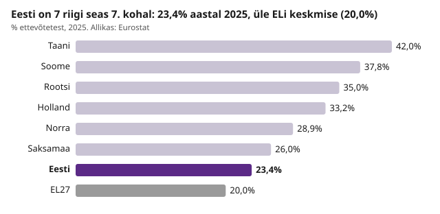

# Tehisaru kasutavad ettevõtted

> Kui suur osa Eesti ettevõtetest kasutab tehisaru võrreldes teiste riikidega?

**Staatus:** ajakohane · **Allikas uuendas:** 2026-06-15 · **Kontrollitud:** 2026-11-19 · **Järgmine oodatav uuendus:** 2027-06-15

## Number

Eesti 2025: **23,4%** · EL27: **20,0%** (% ettevõtetest)

## Mida see tähendab

Näitab, kui laialt on tehisaru jõudnud Eesti ettevõtete igapäevatöösse. Mida rohkem ettevõtteid seda kasutab, seda rohkem töötajaid puutub tehisaruga kokku ja seda olulisemaks muutuvad tehisaru oskused tööturul.

## Vastuolud teiste allikatega

| Allikas | Usaldus | Riik ja aasta | Väärtus | Eurostat | Vahe (pp) | Vastuolu |
| --- | --- | --- | --- | --- | --- | --- |
| [Statistikaamet, uudis 15.09.2025](https://stat.ee/en/news/statistics-estonias-ict-survey-half-estonian-enterprises-use-data-analytics) | ametlik statistika | Eesti 2025 | 22,0% | 23,4% | -1,4 | **jah** |
| [Statistikaamet, tabel IT149 (kõik tegevusalad, 10+ hõivatut)](https://andmed.stat.ee/et/stat/majandus__infotehnoloogia__infotehnoloogia-ettevettes/IT149) | ametlik statistika | Eesti 2025 | 22,2% | 23,4% | -1,2 | **jah** |
| [implicator.ai, viitab Eurostatile](https://www.implicator.ai/denmark-leads-europe-in-business-ai-use-at-42-eurostat-data-shows.md) | teisene allikas | Eesti 2025 | 23,4% | 23,4% | 0,0 | ei |
| [Statistikaamet, tabel IT1490 (laaditud automaatselt)](https://andmed.stat.ee/et/stat/majandus__infotehnoloogia__infotehnoloogia-ettevettes/IT1490) | ametlik statistika | Eesti 2026 | 34,1% | – | – | – |

**Miks allikad erinevad:** Eurostati 23,4% ja Statistikaameti 22,2% (uudises ümardatud 22%) kirjeldavad sama küsitlust, aga põhjus on veel kinnitamata. Üks võimalik põhjus on erinev tegevusalade kogum: Eurostat jätab välja põllumajanduse, kaevandamise ja finantssektori, Statistikaameti "kõik tegevusalad" ei pruugi neid välja jätta. Aastatel 2021–2024 erinevad allikad kõige rohkem 0,1 protsendipunkti, seega ei seleta see üksi 2025. aasta vahet. Kinnitamiseks tuleks küsida Statistikaametilt. Statistikaametil on juba 2026. aasta number (34,1%), Eurostatis seda veel pole. 2026. aasta tabel kasutab uut tegevusalade klassifikaatorit EMTAK 2025, nii et võrdlus varasemate aastatega pole täpne.

## Usaldusväärsus

Ametlik statistika (Eurostat, andmestik `isoc_eb_ai`).

## Piirangud ja riskid

- Arvestab ainult 10 või enama hõivatuga ettevõtteid. Väikseimad ettevõtted jäävad välja.
- Eurostati kogum jätab välja põllumajanduse, kaevandamise ja finantssektori (NACE C10-S951_X_K). Statistikaameti tabelite „kõik tegevusalad“ ei ole sellega täpselt sama.
- Mõõdab, kas ettevõte kasutab vähemalt üht tehisaru tehnoloogiat, mitte seda, kui palju või kui hästi.
- Põhineb ettevõtete enda vastustel küsitluses.
- **Hoiatus:** NL 2025: aegrea katkestus.
- **Hoiatus:** SE 2023: aegrea katkestus.
- **Hoiatus:** Uuem number on juba olemas: Statistikaamet, tabel IT1490 (laaditud automaatselt) annab Eesti 2026. aasta väärtuseks 34,1%. Põhiallikas seda veel ei näita.

## Andmed

| Riik | 2021 | 2023 | 2024 | 2025 |
| --- | --- | --- | --- | --- |
| Eesti | 2,8 | 5,2 | 13,9 | 23,4 |
| Soome | 15,8 | 15,1 | 24,4 | 37,8 |
| Rootsi | 9,9 | 10,4 (b) | 25,1 | 35,0 |
| Taani | 23,9 | 15,2 | 27,6 | 42,0 |
| Norra | 10,8 | 9,2 | 20,8 | 28,9 |
| Saksamaa | 10,6 | 11,6 | 19,8 | 26,0 |
| Holland | 13,1 | 14,1 | 23,1 | 33,2 (b) |
| EL27 | 7,7 | 8,1 | 13,5 | 20,0 |

Sulgudes on Eurostati märgend, nt (p) tähendab esialgset väärtust.

## Allikas

- Andmestik: `isoc_eb_ai`, Artificial intelligence by size class of enterprise
- Näitaja: Annual; Enterprises using at least one of the AI technologies: AI_TTM, AI_TSR, AI_TNLG, AI_TIR, AI_TML, AI_TPA, AI_TAR, E_AI_TPVSG; Percentage of enterprises; 10 persons employed or more; All activities (except agriculture, forestry and fishing, and mining and quarrying), without financial sector
- Päring: https://ec.europa.eu/eurostat/api/dissemination/statistics/1.0/data/isoc_eb_ai?format=JSON&lang=EN&freq=A&indic_is=E_AI_TANY&unit=PC_ENT&size_emp=GE10&nace_r2=C10-S951_X_K&geo=EE&geo=FI&geo=SE&geo=DK&geo=NO&geo=DE&geo=NL&geo=EU27_2020
- Taaskasutus: Eurostati andmeid võib kasutada allikale viidates.

## Muutuste logi

Muutusi pole veel registreeritud.
