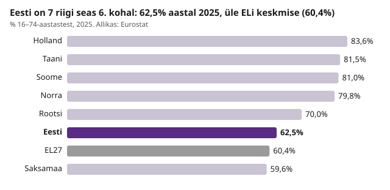

# Vähemalt baastasemel digioskused

> Kui suurel osal Eesti inimestest on vähemalt baastasemel digioskused võrreldes teiste riikidega?

**Staatus:** ajakohane · **Allikas uuendas:** 2026-04-17 · **Kontrollitud:** 2026-10-27 · **Järgmine oodatav uuendus:** 2028-04-17

## Number

Eesti 2025: **62,5%** · EL27: **60,4%** (% 16–74-aastastest)

## Mida see tähendab

Digioskused on tehisaru oskuste alus: kes ei oska teavet otsida, hinnata ega turvaliselt toimetada, sel on raske ka tehisaru kasutada. ELi digikümnendi siht on, et 2030. aastaks oleks vähemalt baastasemel digioskused 80% 16–74-aastastest.

## Vastuolud teiste allikatega

Teisi allikaid pole veel lisatud.

## Usaldusväärsus

Ametlik statistika (Eurostat, andmestik `isoc_sk_dskl_i21`).

## Piirangud ja riskid

- Koondnäitaja viiest valdkonnast (teave ja andmed, suhtlus, sisuloome, turvalisus, probleemide lahendamine). Baastase peab olema kõigis viies.
- Arvutatakse selle järgi, mida inimene ütleb end viimase 3 kuu jooksul teinud olevat. See ei ole oskuste test.
- Küsitakse iga kahe aasta tagant (2021, 2023, 2025). Järgmine number on 2027. aasta kohta.
- Ei mõõda tehisaru oskusi eraldi.
- Statistikaamet ei avalda seda koondnäitajat oma andmebaasis (otsitud 27.10.2026), nii et teist allikat pole.

## Andmed

| Riik | 2021 | 2023 | 2025 |
| --- | --- | --- | --- |
| Eesti | 56,4 | 62,6 | 62,5 |
| Soome | 79,2 | 82,0 | 81,0 |
| Rootsi | 66,6 | 66,4 | 70,0 |
| Taani | 68,7 | 69,6 | 81,5 |
| Norra | 78,7 | 81,1 | 79,8 |
| Saksamaa | 48,9 | 52,2 | 59,6 |
| Holland | 78,9 | 82,7 | 83,6 |
| EL27 | 53,9 | 55,6 | 60,4 |

Sulgudes on Eurostati märgend, nt (p) tähendab esialgset väärtust.

## Allikas

- Andmestik: `isoc_sk_dskl_i21`, Individuals' level of digital skills (from 2021 onwards)
- Näitaja: Annual; Individuals with basic or above basic overall digital skills (all five component indicators are at basic or above basic level); Percentage of individuals; All individuals
- Päring: https://ec.europa.eu/eurostat/api/dissemination/statistics/1.0/data/isoc_sk_dskl_i21?format=JSON&lang=EN&freq=A&indic_is=I_DSK2_BAB&unit=PC_IND&ind_type=IND_TOTAL&geo=EE&geo=FI&geo=SE&geo=DK&geo=NO&geo=DE&geo=NL&geo=EU27_2020
- Taaskasutus: Eurostati andmeid võib kasutada allikale viidates.

## Muutuste logi

Muutusi pole veel registreeritud.
