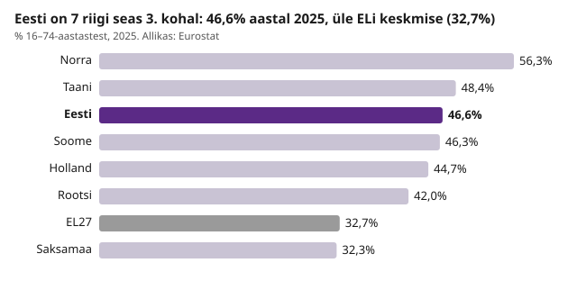

# Tehisaru kasutavad inimesed

> Kui suur osa Eesti inimestest kasutab generatiivse tehisaru tööriistu võrreldes teiste riikidega?

**Staatus:** ajakohane · **Allikas uuendas:** 2026-06-05 · **Kontrollitud:** 2026-11-22 · **Järgmine oodatav uuendus:** 2027-06-05

## Number

Eesti 2025: **46,6%** · EL27: **32,7%** (% 16–74-aastastest)

## Mida see tähendab

Näitab, kui paljud inimesed on generatiivse tehisaru tööriistu (näiteks vestlusroboteid) ise kasutanud. See räägib tehisaru jõudmisest inimeste igapäevaellu ja sellest, kui palju on vaja tehisaru oskuste õpet, mitte sellest, kui hästi inimesed tööriistu kasutavad.

## Vastuolud teiste allikatega

| Allikas | Usaldus | Riik ja aasta | Väärtus | Eurostat | Vahe (pp) | Vastuolu |
| --- | --- | --- | --- | --- | --- | --- |
| [Statistikaamet, tabel IT71 (laaditud automaatselt)](https://andmed.stat.ee/et/stat/majandus__infotehnoloogia__infotehnoloogia-leibkonnas/IT71) | ametlik statistika | Eesti 2026 | 65,0% | – | – | – |

**Miks allikad erinevad:** veel selgitamata. Kirjuta selgitus faili naitajad.json väljale vastuolu_selgitus.

## Usaldusväärsus

Ametlik statistika (Eurostat, andmestik `isoc_ai_iaiu`).

## Piirangud ja riskid

- Hõlmab 16–74-aastaseid. Nooremad ja vanemad jäävad välja.
- Mõõdab ainult generatiivse tehisaru tööriistade kasutust viimase 3 kuu jooksul, mitte muud tehisaru (näiteks soovitusi või tõlget teistes rakendustes).
- Küsimus oli esimest korda 2025. aastal, seega trendi veel pole.
- Põhineb inimeste enda vastustel küsitluses.
- Statistikaameti tabelis IT71 on kaks protsenti: kõigist inimestest ja ainult internetikasutajatest. Siin on kõigist inimestest; internetikasutajate oma on suurem.
- **Hoiatus:** Uuem number on juba olemas: Statistikaamet, tabel IT71 (laaditud automaatselt) annab Eesti 2026. aasta väärtuseks 65,0%. Põhiallikas seda veel ei näita.

## Andmed

| Riik | 2025 |
| --- | --- |
| Eesti | 46,6 |
| Soome | 46,3 |
| Rootsi | 42,0 |
| Taani | 48,4 |
| Norra | 56,3 |
| Saksamaa | 32,3 |
| Holland | 44,7 |
| EL27 | 32,7 |

Sulgudes on Eurostati märgend, nt (p) tähendab esialgset väärtust.

## Allikas

- Andmestik: `isoc_ai_iaiu`, Individuals - use of generative AI tools
- Näitaja: Annual; Use of generative AI tools: in the last 3 months; Percentage of individuals; All individuals
- Päring: https://ec.europa.eu/eurostat/api/dissemination/statistics/1.0/data/isoc_ai_iaiu?format=JSON&lang=EN&freq=A&indic_is=I_IUAI&unit=PC_IND&ind_type=IND_TOTAL&geo=EE&geo=FI&geo=SE&geo=DK&geo=NO&geo=DE&geo=NL&geo=EU27_2020
- Taaskasutus: Eurostati andmeid võib kasutada allikale viidates.

## Muutuste logi

Muutusi pole veel registreeritud.
