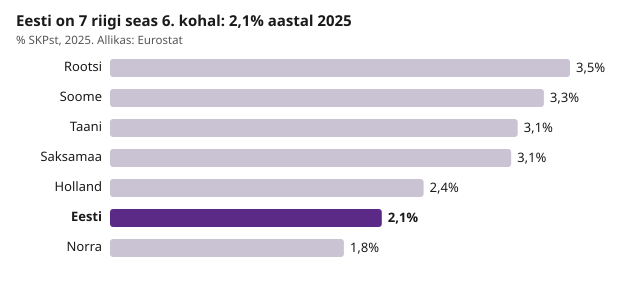

# Teadus- ja arendustegevuse kulud

> Kui palju kulutab Eesti teadus- ja arendustegevusele protsendina SKPst võrreldes teiste riikidega?

**Staatus:** ajakohane · **Allikas uuendas:** 2026-11-03 · **Kontrollitud:** 2026-11-27 · **Järgmine oodatav uuendus:** 2027-11-03

## Number

Eesti 2025: **2,1%** · EL27: **–** (% SKPst)

## Mida see tähendab

Näitab, kui palju ettevõtted, riik ja ülikoolid kokku kulutavad uute teadmiste ja tehnoloogia loomisele. Tehisaru arendamine ja kasutuselevõtt toetuvad sellele alusele.

## Vastuolud teiste allikatega

Teisi allikaid pole veel lisatud.

## Usaldusväärsus

Ametlik statistika (Eurostat, andmestik `rd_e_gerdtot`).

## Piirangud ja riskid

- Kõigi sektorite kulud kokku: ettevõtted, riik, kõrgharidus ja mittetulundussektor.
- Viimase aasta numbrid on esialgsed (p) ja võivad muutuda.
- Number on suhe SKPsse, nii et see muutub ka siis, kui muutub SKP, mitte ainult kulu.
- Ei näita, kui suur osa kuludest läheb tehisarule.
- **Hoiatus:** Aasta 2025 väärtus puudub: EU27_2020.
- **Hoiatus:** DE 2025: esialgne väärtus.
- **Hoiatus:** DK 2019: esialgne väärtus.
- **Hoiatus:** DK 2021: esialgne väärtus.
- **Hoiatus:** DK 2025: hinnanguline väärtus.
- **Hoiatus:** DK 2025: esialgne väärtus.
- **Hoiatus:** EE 2025: esialgne väärtus.
- **Hoiatus:** EU27_2020 2012: hinnanguline väärtus.
- **Hoiatus:** EU27_2020 2013: hinnanguline väärtus.
- **Hoiatus:** EU27_2020 2014: hinnanguline väärtus.
- **Hoiatus:** EU27_2020 2016: hinnanguline väärtus.
- **Hoiatus:** EU27_2020 2018: hinnanguline väärtus.
- **Hoiatus:** EU27_2020 2019: hinnanguline väärtus.
- **Hoiatus:** EU27_2020 2020: hinnanguline väärtus.
- **Hoiatus:** EU27_2020 2021: hinnanguline väärtus.
- **Hoiatus:** EU27_2020 2022: hinnanguline väärtus.
- **Hoiatus:** EU27_2020 2023: hinnanguline väärtus.
- **Hoiatus:** EU27_2020 2024: hinnanguline väärtus.
- **Hoiatus:** FI 2025: esialgne väärtus.
- **Hoiatus:** NL 2012: aegrea katkestus.
- **Hoiatus:** NL 2013: aegrea katkestus.
- **Hoiatus:** NL 2022: aegrea katkestus.
- **Hoiatus:** NL 2025: esialgne väärtus.
- **Hoiatus:** NO 2025: esialgne väärtus.
- **Hoiatus:** SE 2012: hinnanguline väärtus.
- **Hoiatus:** SE 2013: hinnanguline väärtus.
- **Hoiatus:** SE 2014: hinnanguline väärtus.
- **Hoiatus:** SE 2016: hinnanguline väärtus.
- **Hoiatus:** SE 2025: esialgne väärtus.

## Andmed

| Riik | 2012 | 2013 | 2014 | 2015 | 2016 | 2017 | 2018 | 2019 | 2020 | 2021 | 2022 | 2023 | 2024 | 2025 |
| --- | --- | --- | --- | --- | --- | --- | --- | --- | --- | --- | --- | --- | --- | --- |
| Eesti | 2,1 | 1,7 | 1,4 | 1,4 | 1,2 | 1,3 | 1,4 | 1,6 | 1,7 | 1,8 | 1,8 | 1,8 | 2,0 | 2,1 (p) |
| Soome | 3,4 | 3,3 | 3,2 | 2,9 | 2,8 | 2,8 | 2,8 | 2,8 | 2,9 | 3,0 | 3,0 | 3,1 | 3,2 | 3,3 (p) |
| Rootsi | 3,3 (e) | 3,3 (e) | 3,1 (e) | 3,2 | 3,3 (e) | 3,4 | 3,4 | 3,4 | 3,5 | 3,5 | 3,5 | 3,6 | 3,5 | 3,5 (p) |
| Taani | 3,0 | 3,0 | 2,9 | 3,1 | 3,1 | 2,9 | 3,0 | 3,0 (p) | 3,0 | 2,8 (p) | 2,9 | 3,1 | 3,2 | 3,1 (ep) |
| Norra | 1,6 | 1,6 | 1,7 | 1,9 | 2,0 | 2,0 | 2,0 | 2,1 | 2,2 | 1,8 | 1,5 | 1,8 | 1,8 | 1,8 (p) |
| Saksamaa | 2,8 | 2,8 | 2,8 | 2,9 | 2,9 | 3,0 | 3,0 | 3,1 | 3,1 | 3,1 | 3,0 | 3,1 | 3,1 | 3,1 (p) |
| Holland | 1,9 (b) | 2,1 (b) | 2,2 | 2,1 | 2,1 | 2,1 | 2,1 | 2,1 | 2,3 | 2,2 | 2,2 (b) | 2,3 | 2,4 | 2,4 (p) |
| EL27 | 2,1 (e) | 2,1 (e) | 2,1 (e) | 2,1 | 2,1 (e) | 2,1 | 2,2 (e) | 2,2 (e) | 2,3 (e) | 2,2 (e) | 2,2 (e) | 2,3 (e) | 2,3 (e) | – |

Sulgudes on Eurostati märgend, nt (p) tähendab esialgset väärtust.

## Allikas

- Andmestik: `rd_e_gerdtot`, GERD by sector of performance
- Näitaja: Annual; All sectors; Percentage of gross domestic product (GDP)
- Päring: https://ec.europa.eu/eurostat/api/dissemination/statistics/1.0/data/rd_e_gerdtot?format=JSON&lang=EN&freq=A&sectperf=TOTAL&unit=PC_GDP&sinceTimePeriod=2012&geo=EE&geo=FI&geo=SE&geo=DK&geo=NO&geo=DE&geo=NL&geo=EU27_2020
- Taaskasutus: Eurostati andmeid võib kasutada allikale viidates.

## Muutuste logi

Muutusi pole veel registreeritud.
