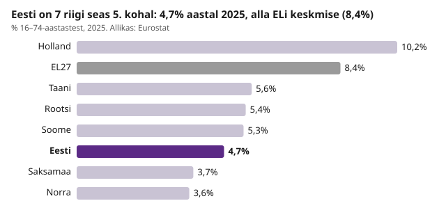

# Ei kasuta tehisaru, sest ei oska

> Kui suur osa inimestest jätab generatiivse tehisaru kasutamata, sest ei oska seda kasutada?

**Staatus:** ajakohane · **Allikas uuendas:** 2026-04-17 · **Kontrollitud:** 2026-11-14 · **Järgmine oodatav uuendus:** 2027-04-17

## Number

Eesti 2025: **4,7%** · EL27: **8,4%** (% 16–74-aastastest)

## Mida see tähendab

Ainus ametlik näitaja, mis mõõdab otse tehisaru oskuse puudust: inimesed, kes ütlevad, et nad ei kasutanud generatiivset tehisaru, sest ei osanud. See näitab, kui paljudele oleks abi tehisaru algõppest.

## Vastuolud teiste allikatega

Teisi allikaid pole veel lisatud.

## Usaldusväärsus

Ametlik statistika (Eurostat, andmestik `isoc_ai_iaiuxr`).

## Piirangud ja riskid

- Eurostati põhjused liituvad mittekasutajate seas 100%-ks, nii et iga inimene on ainult ühes reas. Kes ütles ka „pole vaja“, ei ole siin tõenäoliselt kirjas (kinnitamata), nii et number võib oskuse puudust alahinnata.
- Statistikaamet arvutab sama küsimuse teisiti ja saab Eesti 2025. aasta kohta 13,5%. Eurostati ja Statistikaameti numbreid ei tohi omavahel võrrelda.
- Protsent on kõigist 16–74-aastastest. Mittekasutajate seas on osakaal suurem (Eurostat 2025: 9,75%).
- Põhineb inimeste enda hinnangul. See ei ole oskuste test.

## Andmed

| Riik | 2025 |
| --- | --- |
| Eesti | 4,7 |
| Soome | 5,3 |
| Rootsi | 5,4 |
| Taani | 5,6 |
| Norra | 3,6 |
| Saksamaa | 3,7 |
| Holland | 10,2 |
| EL27 | 8,4 |

Sulgudes on Eurostati märgend, nt (p) tähendab esialgset väärtust.

## Allikas

- Andmestik: `isoc_ai_iaiuxr`, Individuals - reasons for not using generative AI tools
- Näitaja: Annual; Reason for not using generative AI tools: Did not know how to use; Percentage of individuals; All individuals
- Päring: https://ec.europa.eu/eurostat/api/dissemination/statistics/1.0/data/isoc_ai_iaiuxr?format=JSON&lang=EN&freq=A&indic_is=I_IUAIX_NUUSE&unit=PC_IND&ind_type=IND_TOTAL&geo=EE&geo=FI&geo=SE&geo=DK&geo=NO&geo=DE&geo=NL&geo=EU27_2020
- Taaskasutus: Eurostati andmeid võib kasutada allikale viidates.

## Muutuste logi

Muutusi pole veel registreeritud.
