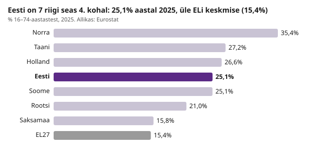

# Tehisaru kasutavad inimesed tööl

> Kui suur osa Eesti inimestest kasutab generatiivse tehisaru tööriistu tööalaselt võrreldes teiste riikidega?

**Staatus:** ajakohane · **Allikas uuendas:** 2026-06-05 · **Kontrollitud:** 2026-11-10 · **Järgmine oodatav uuendus:** 2027-06-05

## Number

Eesti 2025: **25,1%** · EL27: **15,4%** (% 16–74-aastastest)

## Mida see tähendab

Näitab, kui paljud inimesed on generatiivset tehisaru oma töös kasutanud. See on kõige otsesem ametlik märk sellest, kui palju tehisaru oskusi tööl juba vaja läheb. Kasutus ei tähenda, et inimene oskab tööriista hästi kasutada.

## Vastuolud teiste allikatega

| Allikas | Usaldus | Riik ja aasta | Väärtus | Eurostat | Vahe (pp) | Vastuolu |
| --- | --- | --- | --- | --- | --- | --- |
| [Statistikaamet, tabel IT71 (laaditud automaatselt)](https://andmed.stat.ee/et/stat/majandus__infotehnoloogia__infotehnoloogia-leibkonnas/IT71) | ametlik statistika | Eesti 2026 | 36,9% | – | – | – |

**Miks allikad erinevad:** veel selgitamata. Kirjuta selgitus faili naitajad.json väljale vastuolu_selgitus.

## Usaldusväärsus

Ametlik statistika (Eurostat, andmestik `isoc_ai_iaiu`).

## Piirangud ja riskid

- Protsent on kõigist 16–74-aastastest, mitte ainult töötajatest. Töötajate seas on osakaal suurem.
- Mõõdab ainult generatiivse tehisaru tööriistade kasutust viimase 3 kuu jooksul.
- Eurostat küsis seda esimest korda 2025. aastal, Eurostati aegrida veel pole.
- Põhineb inimeste enda vastustel küsitluses. Kasutus ei näita oskuse taset.
- **Hoiatus:** Uuem number on juba olemas: Statistikaamet, tabel IT71 (laaditud automaatselt) annab Eesti 2026. aasta väärtuseks 36,9%. Põhiallikas seda veel ei näita.

## Andmed

| Riik | 2025 |
| --- | --- |
| Eesti | 25,1 |
| Soome | 25,1 |
| Rootsi | 21,0 |
| Taani | 27,2 |
| Norra | 35,4 |
| Saksamaa | 15,8 |
| Holland | 26,6 |
| EL27 | 15,4 |

Sulgudes on Eurostati märgend, nt (p) tähendab esialgset väärtust.

## Allikas

- Andmestik: `isoc_ai_iaiu`, Individuals - use of generative AI tools
- Näitaja: Annual; Use of generative AI tools: for professional (work) purposes; Percentage of individuals; All individuals
- Päring: https://ec.europa.eu/eurostat/api/dissemination/statistics/1.0/data/isoc_ai_iaiu?format=JSON&lang=EN&freq=A&indic_is=I_IUAIWP&unit=PC_IND&ind_type=IND_TOTAL&geo=EE&geo=FI&geo=SE&geo=DK&geo=NO&geo=DE&geo=NL&geo=EU27_2020
- Taaskasutus: Eurostati andmeid võib kasutada allikale viidates.

## Muutuste logi

Muutusi pole veel registreeritud.
